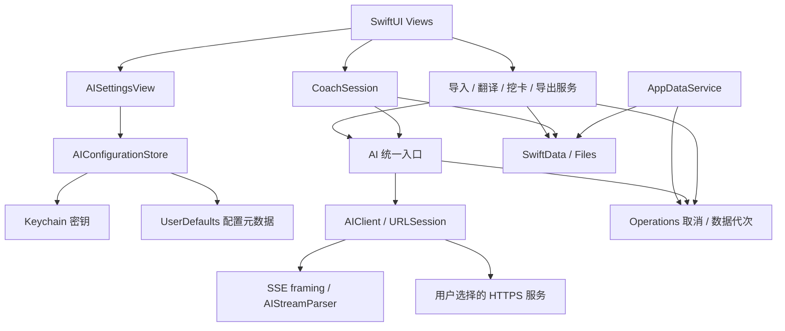

# Yomiori 架构审查与修复

更新：2026-10-29。此文档记录平台移除后的架构拆分和已落实的可靠性边界。保持单应用 target，以业务操作划分模块；暂未引入第三方 AI SDK 或改换数据库。

## 当前依赖关系

## 已修复的问题

| 原问题 | 现在的行为和边界 |
| --- | --- |
| 清空数据逐步吞掉错误，后台结果可能重新写入 | `AppDataService` 先记录持久化清除意图，使 `Operations` 数据代次失效并取消已登记操作。数据库删除使用独立上下文；词表、媒体、音频缓存和应用临时目录清理均报告失败。失败保留标记，启动后阻止继续使用学习内容并提供重试。跨数据库和文件系统使用可重试步骤，不声称是一个原子事务。 |
| PDF 缓存只按页码，字幕缓存缺少语言 | `TranslationKey` 包含源语言、目标语言和按边界编码的文本摘要。PDF 缓存加入页码；字幕加入源/目标语言元数据。旧 PDF 缓存自然失效，旧字幕译文在目标语言不明确时不显示。PDF 独立保存源语言，导入时取当前学习语言，也可在阅读工具栏更改。 |
| PDF 翻页漏译、字幕旧结果覆盖新内容 | PDF 翻译由 `.task(id:)` 直接等待和取消，独立请求身份隔离错误与显示状态；字幕提交时核对字幕身份、文本、源语言及数据代次。输出数量错误会失败，不写入缓存。 |
| 转写只取消外层 Task | `RecognitionOperation` 持有底层识别任务；取消与完成使用锁保护并只恢复一次 continuation。转写强制本机识别，不支持的语言直接报错；MainActor 导入服务校验操作身份后提交。 |
| AI 流把 EOF 和部分回复当成功 | `AIClient` 可注入 URLSession；SSE 字节分帧与协议事件分开。Chat Completions 要求 `[DONE]`；Responses 要求完成事件，处理文本 delta、done、失败、incomplete 和最终文本回退。取消保留 CancellationError 语义。 |
| Coach 回复、纠错独立游离于视图 | `CoachSession` 管理会话、回复和纠错任务。清空/切换/退出使旧会话失效；只有完整回复才持久化，旧纠错不能重新写入。历史查询按语言过滤并限制数量。 |
| AI 地址硬编码、无法在 App 配置 | 设置提供 Responses、Chat Completions 和自建中转，支持完整 HTTPS 地址、模型、可选 Key、双路径连接测试、保存和移除。Key 写入 Keychain；配置变更通过 revision 阻止旧请求提交。 |
| Anki 文件失败或分享取消仍标记已导出 | `AnkiExporter` 接收不可变快照、检查并抛出文件错误，失败清理产物。系统分享完成后才保存已导出标记；取消和失败保留“仅新卡片”资格。导出工作支持取消。 |
| JSON blob 解码失败被空值掩盖 | 字幕、PDF 翻译、批注、纠错增加显式读写接口；兼容 getter 保留错误状态并阻止损坏内容被正常编辑覆盖。字幕按原始 Data 缓存解码快照，播放进度更新不重复解码。 |
| 链接下载手写 continuation、取消存在竞态 | 下载改用 async URLSession；任务身份防止旧进度、旧错误覆盖新请求，离开页面取消，下载结果提交前核对数据代次，导入完成后清理临时文件。 |

## 模块职责

- `Models.swift`：SwiftData 模型、blob 编解码及兼容读取；`Files.swift`：应用文件目录与音频操作。
- `MaterialImport.swift` / `Transcriber.swift`：导入、转写编排与可取消的识别桥接。
- `TranslationService.swift`：缓存键、翻译提交校验和字幕任务状态。
- `CoachSession.swift` / `CoachStage.swift`：会话生命周期、提示词与学习阶段。
- `AIConfiguration.swift` / `AIClient.swift` / `AIStreamParser.swift` / `ServerSentEvents.swift`：配置、凭据、HTTP、协议和分帧；`AI.swift` 提供功能调用入口。
- `CardMining.swift` / `AudioPlayback.swift` / `AnkiExporter.swift`：挖卡、播放与导出。
- `Operations.swift` / `AppDataService.swift`：数据代次、取消登记和清除恢复。
- `ReaderView.swift` / `TappableText.swift` / `ReaderTextView.swift` / `RubyReaderTextView.swift`：阅读编排、Litext 普通选区、CoreText 振假名排版，共用 `ReaderTextContent` 学习标注。
- `CoachMessageContent.swift`：MarkdownView 普通/流式渲染与译文样式；`WordSheet.swift` / `SettingsView.swift` / `ExportSheet.swift`：按界面职责拆出的视图与适配器。

接口采用实际需要的依赖注入：网络可替换 URLSession，Coach 可替换 complete/stream，翻译可替换 translator，清除可替换目录删除器，配置可替换 SecretStorage。没有为每个类型增加空泛的协议层。FlowDown 的包对比和采用理由见 [flowdown-packages.md](flowdown-packages.md)。

## 保留的后续工作

1. **SwiftData 模式迁移**：PDF 新增带默认值的源语言字段，字幕新增可选 JSON 字段以兼容旧数据；尚未引入完整 VersionedSchema / SchemaMigrationPlan，也没有覆盖所有历史真实数据库的迁移矩阵。下次改变实体关系或删除字段前应先补齐版本化 schema。
2. **剩余查询和写入**：阅读、词典等视图仍直接使用 ModelContext，部分列表仍在内存中过滤，部分轻量编辑依赖自动保存。后续可依据大数据量测量逐项收紧；本次并未把所有持久化路径改为仓储层。
3. **Swift 6 迁移**：当前项目使用 Swift 5 语言模式。严格并发检查仍报告 Foundation Predicate/KeyPath 和 AttributedString SDK 相关 Sendable 警告；本次处理了业务回调中的模型捕获、PDF 通知协调器和 GeometryProxy 捕获，不等于完成 Swift 6 全量迁移。
4. **真实设备与服务**：本机测试覆盖本地协议夹具和模拟器；尚未使用真实 API Key 调用外部提供商，也未在真机完成语音权限、各语言本机识别和 Anki 接收应用的验收。

## 验证范围

自动化覆盖词表、卡片快照、本地化、应用元数据，以及新增的协议请求、Responses/SSE 事件、URLSession 分片传输、清除失败重试、过期结果拒绝、Coach 中断/清空、翻译缓存、识别 continuation 和导出失败。SimRun 使用独立数据配置验证 AI 设置入口、空值校验和配置保存后重读。包接入后，Xcode 27.0 / iOS 27.0 模拟器测试共 48 项、10 个套件全部通过，`git diff --check` 通过。中文界面在重启后也成功读取此前保存的配置。

包接入新增 Markdown 片段、UTF-16 命中、振假名换行和 ZIP 内容/取消清理测试。标准 Simulator 又通过 4 项 UI 验收：Markdown 流式完成、阅读器点词/选择查词、设置许可证导航，以及系统分享取消/Save to Files。实际交付 ZIP 已解包核对，完成分享后 exported 标记正确，标准 Simulator 未复现 SimRun 的 FrontBoard 退出。Anki 应用接收端仍未安装验收。详见 [验收记录与截图](acceptance/2026-10-29.md)。普通文本的原生选择和振假名兼容分支说明见 [包接入记录](flowdown-packages.md)。

故障测试使用可注入依赖，不等同于真实磁盘损坏或进程在每个写入指令间被强制终止的完整测试。运行时性能改善尚未做基准测量。
